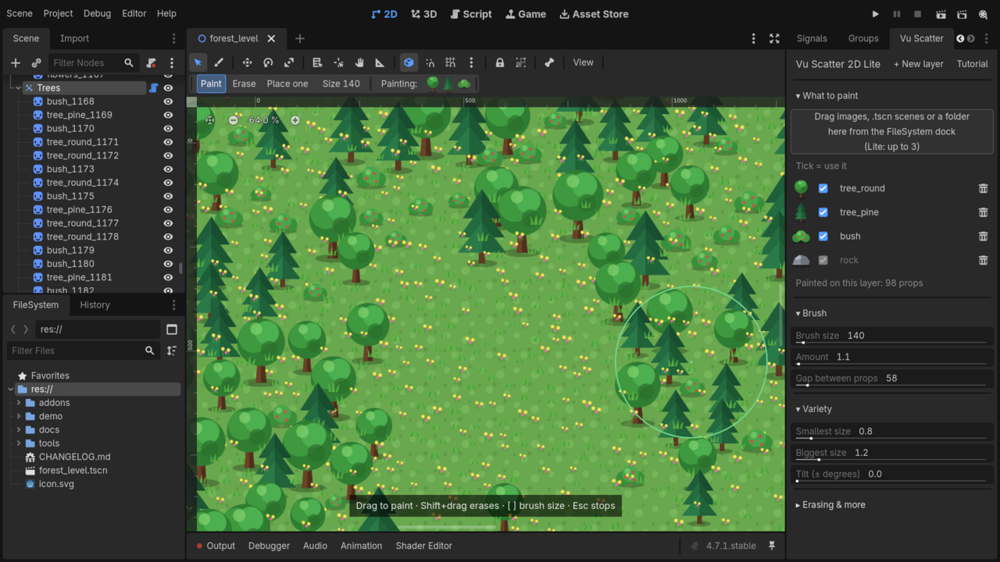

# Vu Scatter 2D Lite

Paint trees, rocks, grass and other props onto your 2D levels, right in the Godot 4 editor. Works on Godot 4.4, 4.5, 4.6 and 4.7.

## What you get (free)

- Brush painting: drag over the 2D view to paint props. Shift + drag erases.
- Place one prop per click.
- Brush size, amount and the gap between props.
- Random size and tilt, so nothing looks copy-pasted.
- Up to 3 props per layer (images or scenes).
- One undo step per stroke. Painted props are normal nodes you can move or delete.
- Erase strength, erase only chosen props, random seed.
- Clear layer and Lock props.
- A Forest demo scene and example trees, bushes and rocks to try it straight away.

## Install

1. In Godot, open the **AssetLib** tab, search for **Vu Scatter 2D Lite**, click **Download**, then **Install**.
   (Or copy the `addons/vu_scatter_2d` folder from this repository into your project.)
2. **Project > Project Settings > Plugins**: tick **Vu Scatter 2D**.
3. The **Vu Scatter** panel opens on the right with a short Getting started list. Follow it.

The full illustrated guide: click the **?** button at the top of the Vu Scatter panel, or open `addons/vu_scatter_2d/USER_GUIDE.pdf` (or `USER_GUIDE.html`).

## Want more?

**Vu Scatter 2D Pro** adds unlimited props with a number for how often each appears, the Shape tool (lines, rectangles, circles, spirals, grid rows, fill area), mirror painting, painting only on your TileMap, random flip and color, draw order, grid snap, the Shuffle brush, presets and four more demo scenes. Scenes made with Lite open unchanged in Pro.

Get it on itch.io: https://vustudio.itch.io/vu-scatter-2d

## License

MIT, see [LICENSE](LICENSE). The demo art is CC0.

Made by Vu Studio.
